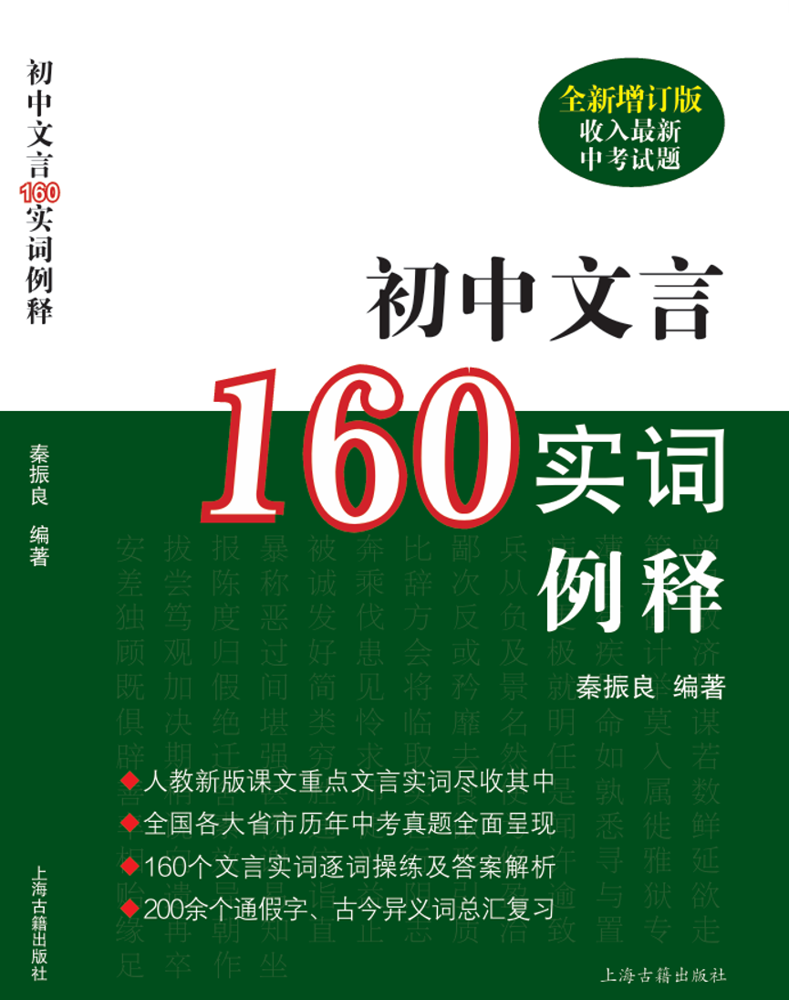

# 秦振良

原上海市位育中学语文教师，全国教育科研优秀教师，徐汇区教育系统语文学科带头人。从教三十九年，先后在《语文学习》《中学语文教学》《语文教学通讯》《语文世界》《新读写》《浙江教育》《文汇报》《中国教师报》《南方周末》等报刊发表文章 200 余篇。出版《高考现代文阅读解题精要》《高中文言 300 实词例释》等 6 本教辅书。

## 📖 出版作品

<table>
<tr>
<td width="50%" valign="top">

**《高中文言 300 实词例释》**（全新增订版） 
**上海古籍出版社**

- 人教新版课文重点文言实词尽收其中
- 近 10 年各省市高考文言真题全面呈现
- 300 个文言实词逐词操练及答案解析
- 400 余个通假字、古今异义词汇总复习

</td>
<td width="50%" valign="top">

**《初中文言 160 实词例释》**（全新增订版，收入最新中考试题） 
**上海古籍出版社**

- 人教新版课文重点文言实词尽收其中
- 全国各大省市历年中考真题全面呈现
- 160 个文言实词逐词操练及答案解析
- 200 余个通假字、古今异义词汇总复习

</td>
</tr>
</table>

另有《高考现代文阅读解题精要》等教辅著作，合计出版教辅书 6 本。

## 🎬 教学视频

**1. 从今年高考文言试题看掌握实词的重要性**（高中，完整版）

- [视频页面](https://github.com/zlqin1960/zlqin1960/releases/tag/video-2026) ｜ [直接下载 MP4](https://github.com/zlqin1960/zlqin1960/releases/download/video-2026/gaokao-wenyan-shici-jiangzuo-full.mp4)

讲座从当年高考文言真题出发，说明文言实词积累对读懂文本、准确答题的关键作用，配合《高中文言 300 实词例释》的使用方法讲解。

**2. 过了实词关，文言并不难**（初中）

- [视频页面](https://github.com/zlqin1960/zlqin1960/releases/tag/video-2026) ｜ [直接下载 MP4](https://github.com/zlqin1960/zlqin1960/releases/download/video-2026/chuzhong-wenyan-160-shichi-jiangzuo.mp4)

面向初中文言文入门，围绕 160 个文言实词的学习路径讲解，配合《初中文言 160 实词例释》使用。

## 📮 联系

- 邮箱：zlqin1960@163.com
- GitHub：zlqin1960
