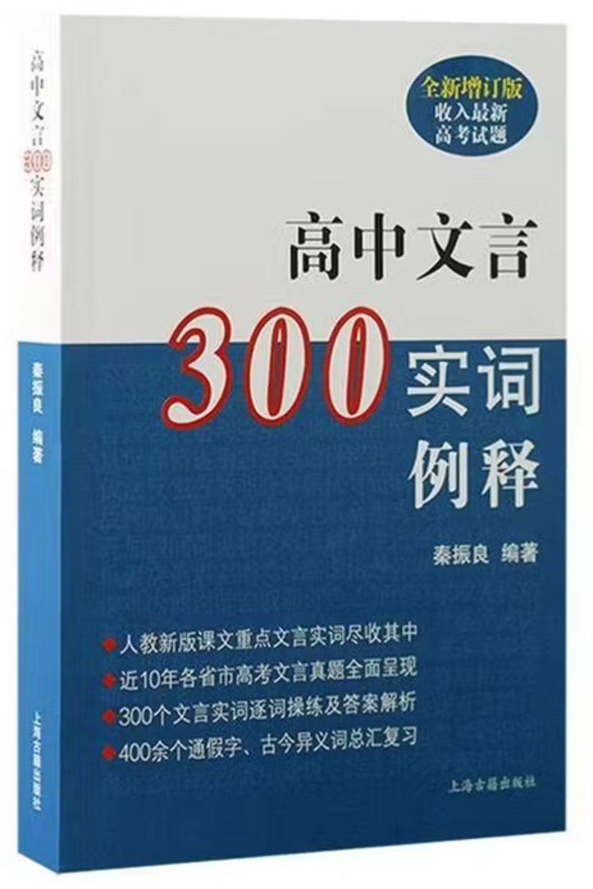

# 秦振良（zlqin1960）

原上海市位育中学语文教师，全国教育科研优秀教师，徐汇区教育系统语文学科带头人。从教三十九年，先后在《语文学习》《中学语文教学》《语文教学通讯》《语文世界》《新读写》《浙江教育》《文汇报》《中国教师报》《南方周末》等报刊发表文章 200 余篇。出版《高考现代文阅读解题精要》《高中文言 300 实词例释》等 6 本教辅书。

## 📖 出版作品

### 《高中文言 300 实词例释》（全新增订版）

**上海古籍出版社出版**

- 人教新版课文重点文言实词尽收其中
- 近 10 年各省市高考文言真题全面呈现
- 300 个文言实词逐词操练及答案解析
- 400 余个通假字、古今异义词汇总复习

另有《高考现代文阅读解题精要》等教辅著作，合计出版教辅书 6 本。

## 📮 联系

- 邮箱：zlqin1960@163.com
- GitHub：zlqin1960
